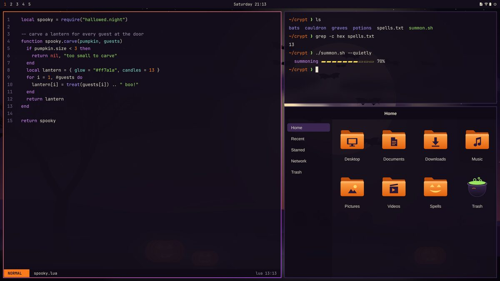
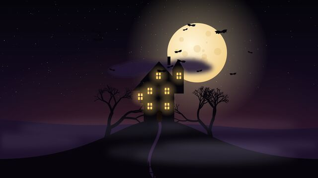
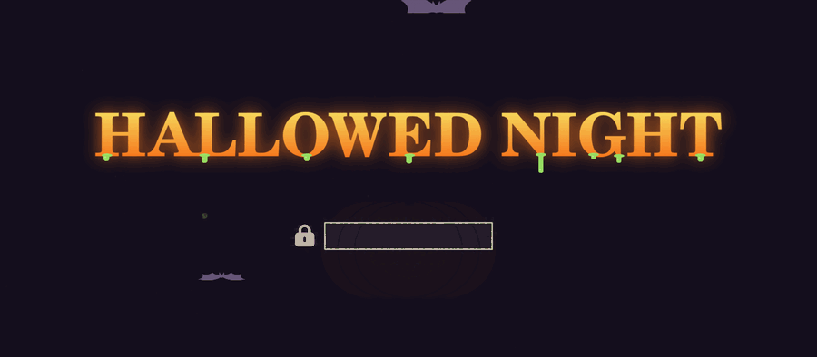
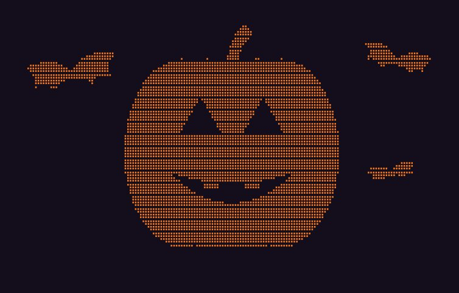
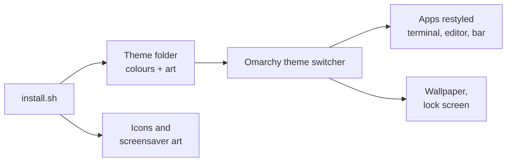

<div align="center">



# omarchy-themes

#### Complete, readable themes for Omarchy 4: colours, wallpapers, intro videos, lock screen, icons and screensaver art in one go.

<a href="https://omarchy.org"></a>
<a href="LICENSE"></a>
<a href="LICENSE-ART.md"></a>


[Themes](#-themes) • [Get started](#-get-started) • [How it works](#-how-it-works) • [FAQ](#-faq-and-troubleshooting) • [For developers](#%EF%B8%8F-for-developers)

</div>

A growing collection of themes for [Omarchy](https://omarchy.org), the Arch Linux and Hyprland setup.
Each theme changes the whole desktop, not just the terminal.
New themes are added here as they are made. Each one is also published as its own small repository, so `omarchy theme install` works too.

## ✨ What you get

- 🎨 **One palette everywhere**: the terminal, Neovim, VS Code, btop, Chromium, the bar, menus and notifications all match.
- 👁️ **Easy to read**: every text colour passes the WCAG AA contrast test (4.5 to 1), and look-alike colours are kept apart.
- 🖼️ **Original wallpapers**: 8 per theme at 4K, plus 21:9 versions for ultrawide monitors.
- 🎬 **Intro videos**: a 6-second animation for each wallpaper that settles on the still image.
- 🔒 **Matching lock and boot screens**: themed lock-screen card, and an animated boot unlock screen with your own text.
- 📁 **Icons**: a small icon set drawn for the theme (folders, bin, terminal). Every other icon comes from Yaru.
- 🌙 **Screensaver art**: the screensaver shows the theme's own picture while that theme is active.
- 🛡️ **Safe to try**: nothing outside your theme folders changes, and `./install.sh --remove` undoes it.

## 🎃 Themes

### Hallowed Night

A classic spooky night: a night-violet sky, bone-white text, jack-o'-lantern orange and toxic green.

<table>
<tr>
<td></td>
<td></td>
<td></td>
<td></td>
</tr>
<tr>
<td></td>
<td></td>
<td></td>
<td></td>
</tr>
</table>

<table>
<tr>
<td width="50%"><br><sub>Animated boot unlock screen (<code>./boot-unlock.sh</code>)</sub></td>
<td width="50%"><br><sub>Screensaver art</sub></td>
</tr>
<tr>
<td colspan="2"><br><sub>Icons</sub></td>
</tr>
</table>

## 🚀 Get started

There are two ways to install. Pick one.

### Option A: the full set (recommended)

This gives you everything, including the icons, screensaver art and ultrawide wallpapers.

1. Open a terminal (<kbd>Super</kbd> + <kbd>Enter</kbd>).
2. Copy the collection to your computer:
   ```bash
   git clone https://github.com/sudharamachandranrajeev/omarchy-themes
   cd omarchy-themes
   ```
3. Run the installer and pick a theme with <kbd>Space</kbd>, then press <kbd>Enter</kbd>:
   ```bash
   ./install.sh
   ```
   Or name the theme directly: `./install.sh hallowed-night`
4. Answer **Yes** when it asks to switch to the theme.
5. Optional: theme the boot unlock screen too (the password screen before Omarchy starts). See [Animated boot unlock screen](#%EF%B8%8F-animated-boot-unlock-screen).

### Option B: colours and wallpapers only

Use Omarchy's own installer. You get the colours, wallpapers, intro videos and lock screen, but not the icons or screensaver art.

```bash
omarchy theme install https://github.com/sudharamachandranrajeev/omarchy-hallowed-night-theme
```

### 🕯️ Animated boot unlock screen

This replaces the Omarchy logo on the boot password screen with your own text. The text glows like a candle, slime drips off the letters, and bats fly past. It uses the current theme's colours.

1. Look at it first. This opens it in a window for 15 seconds and changes nothing:
   ```bash
   ./boot-unlock.sh --preview
   ```
   The first run makes a settings file at `~/.config/omarchy-themes/settings.toml`.
2. To change the text or font, open that file and edit it:
   ```toml
   [boot_unlock]
   text = "HALLOWED NIGHT"   # up to 32 letters, digits, spaces or . , ! ? ' & : + -
   font = "C059:bold"        # any installed font; list them with: fc-list : family style
   ```
   Then run `./boot-unlock.sh --preview` again to see it.
3. Install it. It asks for your password, because the boot screen is a system file:
   ```bash
   ./boot-unlock.sh
   ```
   You see it the next time you start the computer.
4. To go back to Omarchy's own boot screen: `./boot-unlock.sh --restore`

Your text stays on your computer. It is drawn locally and never added to this repository.

### Switch back or remove

- To switch theme: <kbd>Super</kbd> + <kbd>Ctrl</kbd> + <kbd>Shift</kbd> + <kbd>Space</kbd>, or `omarchy theme set <name>`.
- To remove a theme installed with Option A, switch to another theme first, then run `./install.sh --remove hallowed-night`.

## 🧭 How it works



- Each theme is one folder in `themes/`. Its `colors.toml` holds the palette, and Omarchy builds every app's colours from it.
- `install.sh` copies the folder into `~/.config/omarchy/themes/`. Then it adds the extras that Omarchy's own installer cannot add.
- The screensaver hook copies the theme's art into place when you switch to it. When you switch away, it puts your own art back.
- If you already had a theme with the same name, the installer moves it to `~/.local/state/omarchy-themes/backup/` rather than deleting it.

## ❓ FAQ and troubleshooting

<details>
<summary><b>My icons look broken after switching theme</b></summary>

Omarchy passes the icon theme name straight to GTK, and a name that is not installed breaks every icon. The installer only switches to a theme's own icons after it has installed them. If you copied a theme folder by hand, run `./install.sh <theme>` again.
</details>

<details>
<summary><b>The screensaver still shows my old art</b></summary>

The art is swapped when you switch theme. Run `omarchy theme set hallowed-night` once after installing. The screensaver hook only comes with Option A.
</details>

<details>
<summary><b>I changed my screensaver art and the theme overwrote it</b></summary>

While a collection theme is active, your own art is kept in `~/.config/omarchy/branding/screensaver.txt.pre-omarchy-themes`. Switch to another theme to get it back, then change it.
</details>

<details>
<summary><b>The boot screen went back to the Omarchy logo</b></summary>

Picking a logo with `omarchy plymouth switcher` sets Omarchy's own boot screen again, and an Omarchy update that refreshes the boot screen may do the same. Run `./boot-unlock.sh` again to bring yours back.
</details>

<details>
<summary><b>The boot screen preview does not open</b></summary>

The preview needs `bubblewrap` (`omarchy pkg add bubblewrap`) and Xwayland, which Omarchy has by default. Installing with `./boot-unlock.sh` does not need either.
</details>

<details>
<summary><b>Where are the ultrawide wallpapers?</b></summary>

The installer adds them only when a monitor is wider than 21:9. You can also copy them from `wallpapers/<theme>/ultrawide/` into `~/.config/omarchy/backgrounds/<theme>/`.
</details>

<details>
<summary><b>Does this work on Omarchy 3?</b></summary>

No. The themes use the Omarchy 4 theme format and ship no Omarchy 3 files (such as waybar or walker styles).
</details>

## 🛠️ For developers

<details>
<summary>Build, check and publish</summary>

All artwork is drawn by code, so every image can be rebuilt. You need `python3`, `rsvg-convert` (librsvg), ImageMagick, `ffmpeg` and an Omarchy install.

```bash
# Wallpapers (4K), ultrawide versions and intro videos
generators/render.py wallpapers hallowed_night themes/hallowed-night/backgrounds
generators/render.py wallpapers hallowed_night wallpapers/hallowed-night/ultrawide --width 5120
generators/render.py intros hallowed_night themes/hallowed-night/backgrounds/intros

# Icons, unlock logo, screensaver art and previews
generators/hallowed_icons.py icons/hallowed-night
generators/hallowed_branding.py themes/hallowed-night icons/hallowed-night

# Checks: required files, contrast, icon names, stale Omarchy 3 files
tools/check.py

# README images (add --boot-unlock to record the boot screen GIF), then the stand-alone theme repo
tools/screenshots.sh hallowed-night --boot-unlock
tools/publish.sh hallowed-night          # add --push to publish
```

To add a theme: make `themes/<slug>/` with a `colors.toml` (line 1 `# Name — tagline`), add a generator in `generators/`, then run the steps above. `tools/check.py` runs on every push.
</details>

## Credits

- Built for [Omarchy](https://github.com/omacom/omarchy). Each `unlock.png` is a recoloured Omarchy wordmark (MIT). The animated boot screen script builds on Omarchy's Plymouth script and uses its password box images (MIT).
- Icons not drawn here come from [Yaru](https://github.com/ubuntu/yaru).
- Screensaver animation by Omarchy's `ttfx` effects.

## License

Code is [MIT](LICENSE). Artwork is [CC BY 4.0](LICENSE-ART.md).

> GitHub [@sudharamachandranrajeev](https://github.com/sudharamachandranrajeev)
