<div align="center">


# omarchy-themes

#### Complete, readable themes for Omarchy 4: colours, wallpapers, intro videos, lock screen, icons and screensaver art in one go.

<a href="https://omarchy.org"></a>
<a href="LICENSE"></a>
<a href="LICENSE-ART.md"></a>


[Themes](#-themes) • [Get started](#-get-started) • [Customise](#%EF%B8%8F-theme-customiser) • [How it works](#-how-it-works) • [FAQ](#-faq-and-troubleshooting) • [For developers](#%EF%B8%8F-for-developers)

</div>

A growing collection of themes for [Omarchy](https://omarchy.org), the Arch Linux and Hyprland setup.
Each theme changes the whole desktop, not just the terminal.
New themes are added here as they are made. Every theme lives in this one repository.

## ✨ What you get

- 🎨 **One palette everywhere**: the terminal, Neovim, VS Code, btop, Chromium, the bar, menus and notifications all match.
- 👁️ **Easy to read**: every text colour passes the WCAG AA contrast test (4.5 to 1), and look-alike colours are kept apart.
- 🖼️ **Original wallpapers**: 8 per theme at 4K, plus 21:9 versions for ultrawide monitors.
- 🎬 **Intro videos**: a 6-second animation for each wallpaper that settles on the still image.
- 🔒 **Matching lock and boot screens**: themed lock-screen card, and an animated boot unlock screen with your own text.
- 🎛️ **Theme Customiser**: a menu for switching themes, changing the accent colour and setting up the boot screen, opened from the Omarchy menu.
- 📁 **Icons**: some themes add a small icon set of their own (folders, bin, terminal). Every other icon comes from Yaru.
- 🌙 **Screensaver art**: the screensaver shows the theme's own picture while that theme is active.
- 🛡️ **Safe to try**: nothing outside your theme folders changes, and `./install.sh --remove` undoes it.

## 🎃 Themes

### Halloween Night

A classic spooky night: a night-violet sky, bone-white text, jack-o'-lantern orange and toxic green.

<table>
<tr>
<td></td>
<td></td>
<td></td>
<td></td>
</tr>
<tr>
<td>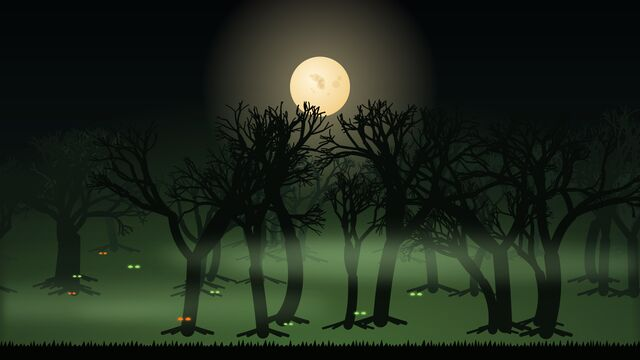</td>
<td>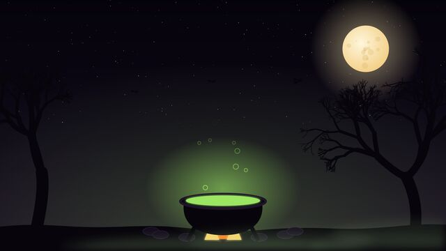</td>
<td></td>
<td>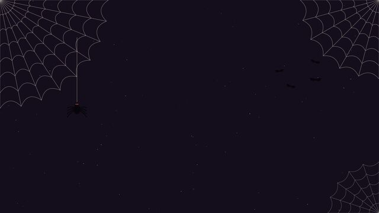</td>
</tr>
</table>

<table>
<tr>
<td width="50%">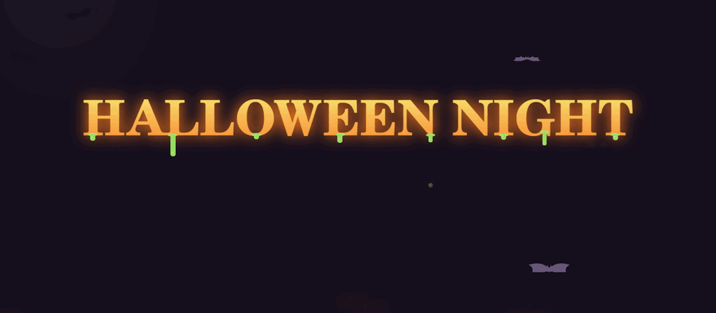<br><sub>Animated boot unlock screen (<code>./boot-unlock.sh</code>)</sub></td>
<td width="50%"><br><sub>Screensaver art</sub></td>
</tr>
<tr>
<td colspan="2"><br><sub>Icons</sub></td>
</tr>
</table>

### Monograph

A quiet theme built around type. Every wallpaper is set in the Omarchy font (JetBrains Mono), in warm paper-white and brass on a dark ink background. The boot screen says **WELCOME** and your first name.

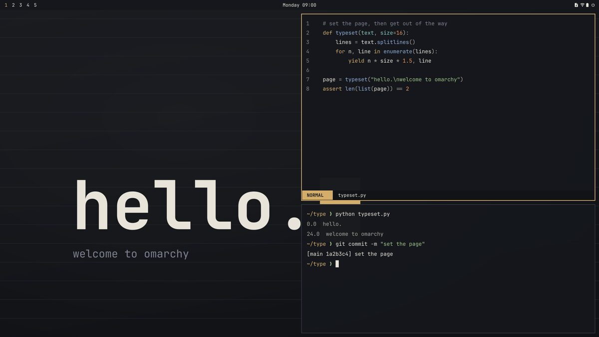

<table>
<tr>
<td>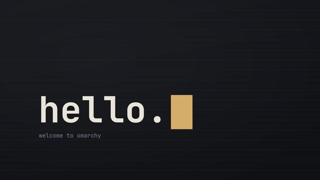</td>
<td>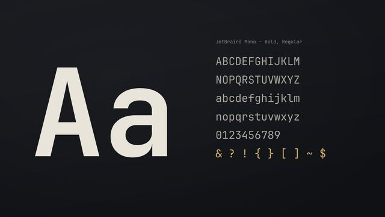</td>
<td>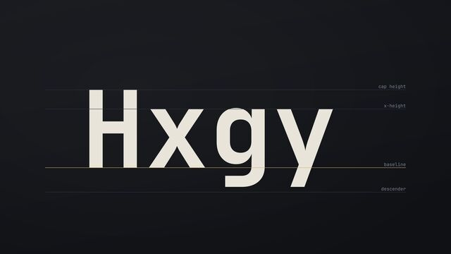</td>
<td>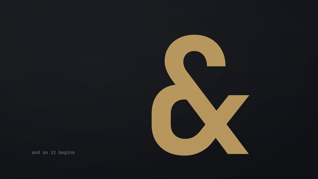</td>
</tr>
<tr>
<td>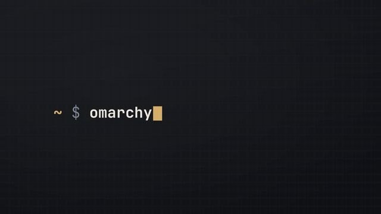</td>
<td>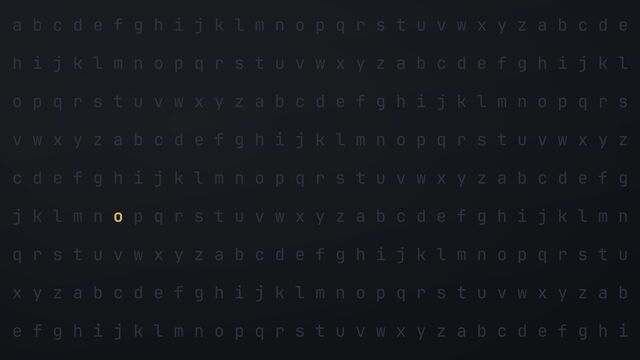</td>
<td>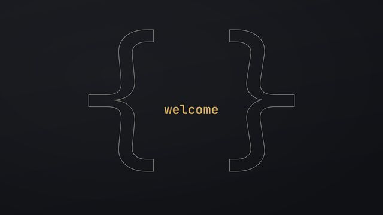</td>
<td>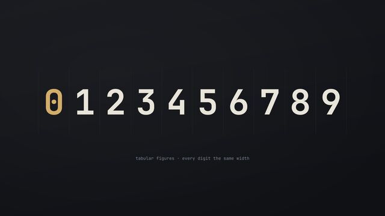</td>
</tr>
</table>

<table>
<tr>
<td width="50%">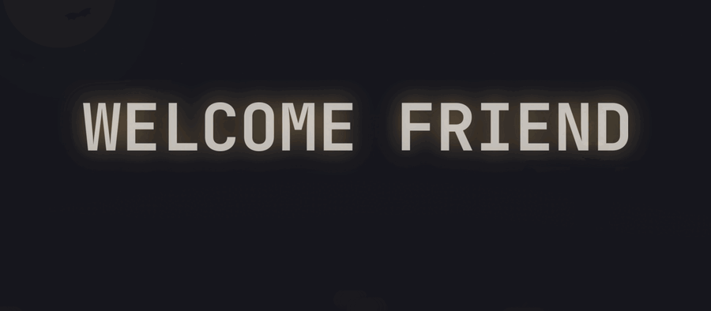<br><sub>Animated boot unlock screen. It shows your own name.</sub></td>
<td width="50%">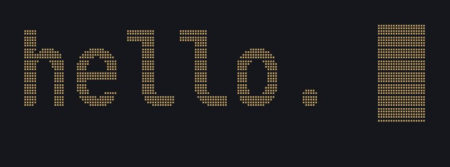<br><sub>Screensaver art</sub></td>
</tr>
</table>

## 🚀 Get started

This gives you everything, including the icons, screensaver art and ultrawide wallpapers.

1. Open a terminal (<kbd>Super</kbd> + <kbd>Enter</kbd>).
2. Copy the collection to your computer:
   ```bash
   git clone https://github.com/sudharamachandranrajeev/omarchy-themes
   cd omarchy-themes
   ```
3. Run the installer and pick a theme with <kbd>Space</kbd>, then press <kbd>Enter</kbd>:
   ```bash
   ./install.sh
   ```
   Or name the theme directly: `./install.sh monograph`
4. Answer **Yes** when it asks to switch to the theme.
5. Optional: open the [Theme Customiser](#%EF%B8%8F-theme-customiser) to change the accent colour or theme the boot screen too.

## 🎛️ Theme Customiser

One menu for the whole collection. The installer adds it to the Omarchy menu for you.

1. Press <kbd>Super</kbd> + <kbd>Space</kbd>, choose **Style**, then **Theme Customiser**.
   Or run `./customise.sh` from the `omarchy-themes` folder.
2. Use the arrow keys and <kbd>Enter</kbd> to pick:
   - **Switch theme**: change to another theme from the collection. It installs the theme first if needed.
   - **Accent colour**: pick another colour from the theme, or type your own. Colours that would be hard to read are refused. **Reset** puts the theme's own colour back.
   - **Boot screen**: change the text, font and your name, preview it, and install it. See below.
   - **Remove a theme**: remove a collection theme you are not using.

If the menu item is missing, run `./customise.sh --add-menu`.

### 🕯️ Animated boot unlock screen

This replaces the Omarchy logo on the boot password screen (the screen before Omarchy starts) with your own text. Each theme has its own animation:

- **Halloween Night**: the text glows like a candle, slime drips off the letters, and bats fly past.
- **Monograph**: **WELCOME** and your name fade in, a brass line draws itself underneath, and a cursor blinks.

The easy way is the [Theme Customiser](#%EF%B8%8F-theme-customiser): choose **Boot screen**, then **Preview** and **Install**.

To do it from a terminal instead:

1. Look at it first. This opens it in a window for 15 seconds and changes nothing:
   ```bash
   ./boot-unlock.sh --preview
   ```
2. To change the text, font or name, edit `~/.config/omarchy-themes/settings.toml`:
   ```toml
   name = "Ada"                  # used for {NAME} (in capitals) and {name}

   [boot_unlock.monograph]
   text = "WELCOME {NAME}"       # up to 32 letters, digits, spaces or . , ! ? ' & : + -
   font = "omarchy:bold"         # "omarchy" means the Omarchy font; list others with: fc-list : family style
   ```
   Then run `./boot-unlock.sh --preview` again to see it.
3. Install it. It asks for your password, because the boot screen is a system file:
   ```bash
   ./boot-unlock.sh
   ```
   You see it the next time you start the computer.
4. To go back to Omarchy's own boot screen: `./boot-unlock.sh --restore`

Your name and text stay on your computer. They are drawn locally and never added to this repository.

### Switch back or remove

- To switch theme: use the Theme Customiser, <kbd>Super</kbd> + <kbd>Ctrl</kbd> + <kbd>Shift</kbd> + <kbd>Space</kbd>, or `omarchy theme set <name>`.
- To remove a theme, switch to another theme first. Then use **Remove a theme** in the Theme Customiser, or run `./install.sh --remove halloween-night`.

## 🧭 How it works

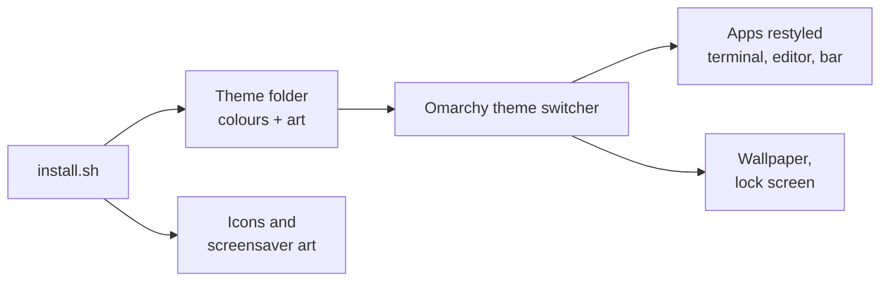

- Each theme is one folder in `themes/`. Its `colors.toml` holds the palette, and Omarchy builds every app's colours from it.
- `install.sh` copies the folder into `~/.config/omarchy/themes/`. Then it adds the extras that Omarchy's own installer cannot add.
- The screensaver hook copies the theme's art into place when you switch to it. When you switch away, it puts your own art back.
- If you already had a theme with the same name, the installer moves it to `~/.local/state/omarchy-themes/backup/` rather than deleting it.

## ❓ FAQ and troubleshooting

<details>
<summary><b>My icons look broken after switching theme</b></summary>

Omarchy passes the icon theme name straight to GTK, and a name that is not installed breaks every icon. The installer only switches to a theme's own icons after it has installed them. If you copied a theme folder by hand, run `./install.sh <theme>` again.
</details>

<details>
<summary><b>The screensaver still shows my old art</b></summary>

The art is swapped when you switch theme. Run `omarchy theme set halloween-night` once after installing.
</details>

<details>
<summary><b>I changed my screensaver art and the theme overwrote it</b></summary>

While a collection theme is active, your own art is kept in `~/.config/omarchy/branding/screensaver.txt.pre-omarchy-themes`. Switch to another theme to get it back, then change it.
</details>

<details>
<summary><b>The boot screen went back to the Omarchy logo</b></summary>

Picking a logo with `omarchy plymouth switcher` sets Omarchy's own boot screen again, and an Omarchy update that refreshes the boot screen may do the same. Run `./boot-unlock.sh` again to bring yours back.
</details>

<details>
<summary><b>The Monograph boot screen shows my user name, not my first name</b></summary>

The name comes from the full name on your account. If that is empty, your login name is used. Set it in the Theme Customiser (**Boot screen**, then **Your name**), then install the boot screen again.
</details>

<details>
<summary><b>I changed the accent colour and want the original back</b></summary>

In the Theme Customiser, choose **Accent colour**, then **Reset to the theme's own**. Installing the theme again with `./install.sh <theme>` also puts it back.
</details>

<details>
<summary><b>The boot screen preview does not open</b></summary>

The preview needs `bubblewrap` (`omarchy pkg add bubblewrap`) and Xwayland, which Omarchy has by default. Installing with `./boot-unlock.sh` does not need either.
</details>

<details>
<summary><b>Where are the ultrawide wallpapers?</b></summary>

The installer adds them only when a monitor is wider than 21:9. You can also copy them from `wallpapers/<theme>/ultrawide/` into `~/.config/omarchy/backgrounds/<theme>/`.
</details>

<details>
<summary><b>Does this work on Omarchy 3?</b></summary>

No. The themes use the Omarchy 4 theme format and ship no Omarchy 3 files (such as waybar or walker styles).
</details>

## 🛠️ For developers

<details>
<summary>Build and check</summary>

All artwork is drawn by code, so every image can be rebuilt. You need `python3`, `rsvg-convert` (librsvg), ImageMagick, `ffmpeg` and an Omarchy install.

```bash
# Wallpapers (4K), ultrawide versions and intro videos
generators/render.py wallpapers halloween_night themes/halloween-night/backgrounds
generators/render.py wallpapers halloween_night wallpapers/halloween-night/ultrawide --width 5120
generators/render.py intros halloween_night themes/halloween-night/backgrounds/intros

# Icons, unlock logo, screensaver art and previews
generators/halloween_icons.py icons/halloween-night
generators/halloween_branding.py themes/halloween-night icons/halloween-night

# Monograph: wallpapers, intro videos, then unlock logo, screensaver art and previews
generators/render.py wallpapers monograph themes/monograph/backgrounds
generators/render.py intros monograph themes/monograph/backgrounds/intros
generators/monograph_branding.py themes/monograph

# Checks: required files, contrast, icon names, stale Omarchy 3 files
tools/check.py

# README images (add --boot-unlock to record the boot screen GIF)
tools/screenshots.sh halloween-night --boot-unlock
```

To add a theme: make `themes/<slug>/` with a `colors.toml` (line 1 `# Name — tagline`), add a generator in `generators/`, then run the steps above. `tools/check.py` runs on every push.

To give a theme a boot screen, add `plymouth/<slug>.toml` with its default `text`, `font` and `style`. A style is an animation in `plymouth/<style>.script` plus its images in `generators/boot_unlock.py`; `spooky` and `calm` exist now.
</details>

## Credits

- Built for [Omarchy](https://github.com/omacom/omarchy). Halloween Night's `unlock.png` is a recoloured Omarchy wordmark (MIT). The animated boot screen script builds on Omarchy's Plymouth script and uses its password box images (MIT).
- Icons not drawn here come from [Yaru](https://github.com/ubuntu/yaru).
- Monograph's art is set in [JetBrains Mono](https://www.jetbrains.com/lp/mono/) (SIL Open Font License), the Omarchy font.
- Screensaver animation by Omarchy's `ttfx` effects.

## License

Code is [MIT](LICENSE). Artwork is [CC BY 4.0](LICENSE-ART.md).

> GitHub [@sudharamachandranrajeev](https://github.com/sudharamachandranrajeev)
